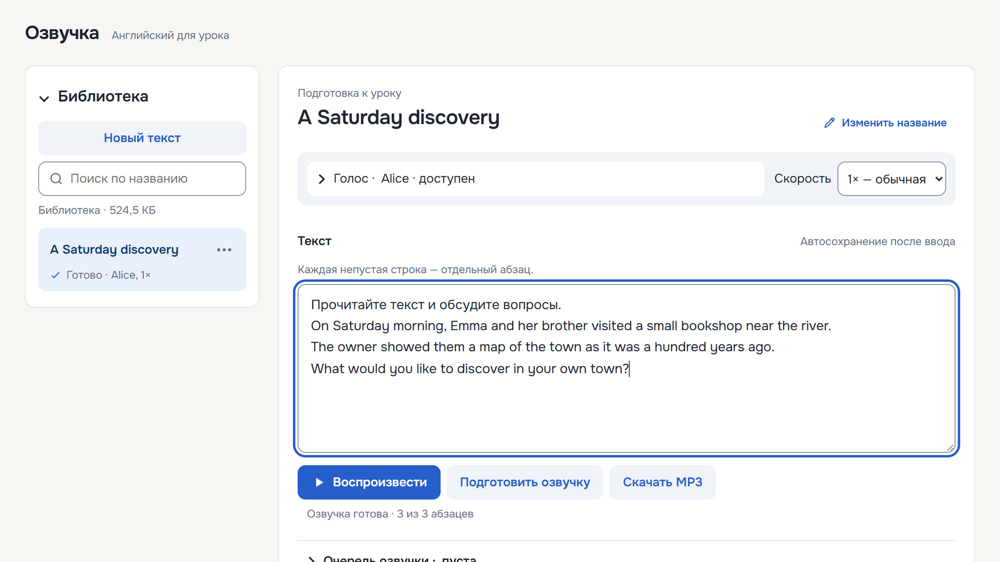

# Озвучка — английские тексты для урока

Вставьте английский текст, выберите голос и скорость — «Озвучка» прочитает его вслух. Программа помогает проводить аудирование, повторять отдельные абзацы и показывать текст крупно на проекторе.

Работает **без интернета**. Тексты и подготовленные озвучки сохраняются в библиотеке: их можно использовать на следующих уроках. Программу вместе с библиотекой можно переносить на флешке.

## Скачать для Windows

**[Скачать последнюю версию](https://github.com/AlexeyDesyatnik/simple-english-tts/releases/latest)**

На странице выпуска раскройте **Assets** и скачайте архив `ozvuchka-<версия>.zip`. Файлы **Source code** для запуска не нужны.

Нужен компьютер с **Windows 10 или 11, 64-разрядной версии (x64)**, и динамики или наушники. Устанавливать Python и скачивать голоса отдельно не требуется. Интернет нужен только для скачивания программы.

## Скачать для Linux

**[Скачать последнюю версию](https://github.com/AlexeyDesyatnik/simple-english-tts/releases/latest)**

На странице выпуска раскройте **Assets** и скачайте архив `ozvuchka-<версия>-linux-x86_64.tar.gz`. Файлы **Source code** для запуска не нужны.

Нужен **Linux x86-64 с glibc 2.29 или новее**, современный Firefox или браузер на основе Chromium, а также динамики или наушники. Устанавливать Python, голоса, eSpeak или программы для MP3 отдельно не требуется. Интернет нужен только для скачивания программы.

## Первый запуск в Windows

1. Скачайте архив на компьютер.
2. Нажмите на него правой кнопкой мыши → **Свойства**. Если внизу есть пункт **Разблокировать**, отметьте его и нажмите **ОК**. Делайте это только для архива, скачанного со страницы проекта выше.
3. Распакуйте архив целиком в папку, в которой вы можете сохранять файлы, например в «Документы». Не запускайте программу прямо из архива.
4. Откройте распакованную папку **Озвучка** и дважды нажмите **Озвучка.exe**.

Откроется окно программы или вкладка браузера. Это нормально: интернет для работы не нужен. При первом запуске, особенно с флешки, загрузка голосов может занять некоторое время.

Если Windows блокирует запуск, закройте программу, разблокируйте исходный архив через его свойства и распакуйте его в новую папку.

## Первый запуск в Linux

1. Скачайте архив на компьютер.
2. Распакуйте архив целиком в папку, в которой вы можете сохранять файлы, например в «Документы». Не запускайте программу прямо из архива. Архив сохраняет возможность запуска `Озвучка.sh`: отдельно менять права доступа не нужно.
3. Откройте распакованную папку **Озвучка** и запустите **Озвучка.sh** двойным щелчком. Если файловый менеджер открывает файл как текст, выберите запуск через его контекстное меню или откройте папку в терминале и выполните `./Озвучка.sh`.

Откроется страница программы в браузере по умолчанию. Размер и положение окна браузера программа не сохраняет. SmartScreen и разблокировка архива относятся только к Windows. Интернет для работы не нужен; при первом запуске, особенно с флешки, загрузка голосов может занять некоторое время.

## Первый текст для урока

1. Нажмите **Новый текст** и вставьте английский текст. Каждая непустая строка считается отдельным абзацем: его можно прослушать и повторить отдельно.
2. Выберите **голос**. Кнопка **Послушать** позволяет заранее послушать его образец.
3. Выберите **скорость**: например, замедлите чтение для начинающих.
4. Нажмите **Воспроизвести**. Программа сохранит текст в библиотеке и начнёт готовить озвучку. Если нужно подождать, состояние будет показано на экране.

На медленном компьютере удобнее подготовиться до урока: вставьте текст, выберите голос и скорость, нажмите **Подготовить озвучку** и дождитесь готовности. Затем откройте этот текст из библиотеки и нажмите **Воспроизвести** с теми же голосом и скоростью — повторная подготовка не потребуется.

Текст сохраняется автоматически после ввода. Перед закрытием программы убедитесь, что рядом с полем текста появилось «Сохранено».

## Скачать озвучку в MP3

Когда озвучка полностью готова, нажмите **Скачать MP3** рядом с **Подготовить озвучку**. Если кнопка недоступна, сначала дождитесь готовности всех английских абзацев. Программа скачивает текущий текст с выбранными голосом и скоростью; строки с русскими инструкциями в файл не попадают.

Браузер сохранит файл в своей папке загрузок или спросит, куда его сохранить. Имя файла содержит название текста, голос и скорость. Готовый MP3 можно открыть в обычном проигрывателе или использовать на другом устройстве. Удаление текста из библиотеки не удаляет уже скачанный файл.

## Во время урока

- **Пауза** приостанавливает чтение; **Продолжить** продолжает его. Это одна кнопка, название которой меняется во время чтения.
- Нажмите на нужный абзац, чтобы читать с него. Кнопки **Назад**, **Вперёд** и **Повторить абзац** помогают работать с отдельными частями текста.
- **К редактированию** останавливает чтение и возвращает к подготовке текста.
- **A− / A+** уменьшают и увеличивают текст для показа на проекторе.
- В режиме воспроизведения, когда фокус находится вне кнопок и полей, **пробел** ставит чтение на паузу и продолжает его, **← / →** переключают абзацы, **R** (клавиша **К** в русской раскладке) повторяет абзац.
- Строки без английского текста, например русские инструкции к заданию, остаются на экране, но не читаются вслух.

Чтобы закончить работу, закройте окно программы или её вкладку в браузере.

## Как выглядит программа

## Флешка, библиотека и обновление

**Для работы с флешки** сначала распакуйте архив на компьютере, затем скопируйте на флешку всю папку **Озвучка**. На другом компьютере запустите **Озвучка.exe** в Windows или **Озвучка.sh** в Linux. Копирование множества файлов и первый запуск могут занять несколько минут. В Linux флешка должна разрешать запуск файлов: конфигурация с параметром `noexec` не поддерживается. В таком случае скопируйте папку программы, например, в «Документы».

**Ваша библиотека** хранится в папке `data` внутри папки программы. Для резервной копии закройте программу, подождите около 10 секунд и скопируйте `data` в безопасное место. Перед извлечением флешки также закройте программу и дождитесь её завершения.

Папку `data` можно переносить между Windows и Linux: закройте программу на исходном компьютере и скопируйте папку целиком. Тексты и уже подготовленные озвучки будут доступны на другом компьютере без повторного синтеза.

**Для обновления с сохранением библиотеки:**

1. Закройте программу и подождите около 10 секунд.
2. Сделайте резервную копию папки `data`.
3. Скачайте и распакуйте новый выпуск в отдельную папку.
4. Скопируйте в неё свою папку `data`, рядом с новым **Озвучка.exe** или **Озвучка.sh**, до первого запуска.
5. Запустите новую версию и убедитесь, что ваши тексты на месте. Старую папку сохраните до этой проверки.

---

[Документация для разработчиков](docs/development.md)
