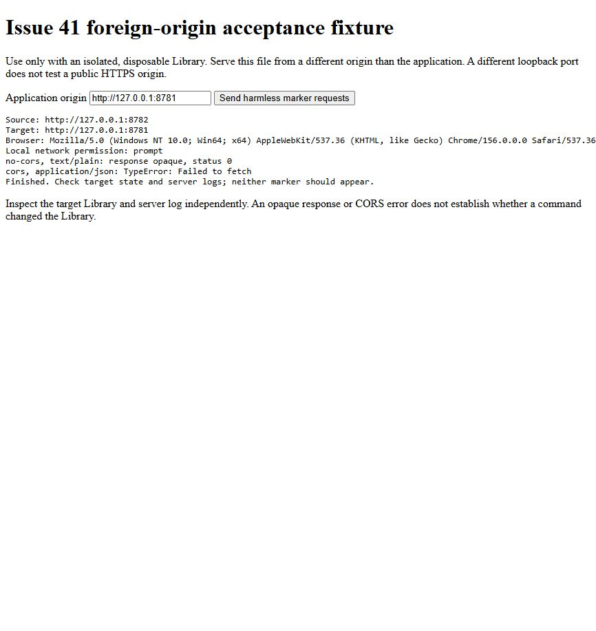

# Issue #41 — HTTP protection verification

Date: 2026-11-05. Status: accepted by the developer for closure. HTTP
implementation, release smoke, developer everyday browser acceptance and in-app
Chromium foreign-loopback-origin checks passed. The developer explicitly judged
these checks sufficient and requested closure of #41. Edge-specific, public
HTTPS-origin and explicitly allowed LNA checks were not performed and are not
required for this accepted scope. Agent checks used disposable Libraries.

## Implemented policy

GET and command requests require exactly one Host matching `127.0.0.1:<port>`
or `localhost:<port>`, using the server's actual bound port. At port 80, the
authorities without a port are also supported. The server still binds only IPv4
loopback; IPv6, foreign names and different ports are not supported authorities.

Commands permit absent Origin for Python launcher/tools, or exactly one Origin
matching one of the supported HTTP application origins. Foreign, empty, `null`
and duplicate Origin headers are rejected with 403 before invoking Core. Origin
is compared against supported application origins, not an arbitrary Host value.

Commands require one `application/json` Content-Type (case-insensitive, with
parameters such as `charset=utf-8` accepted); unsupported/missing/duplicate
Content-Type is rejected with 415. No CORS permissions are added; foreign
preflight is not allowed. This does not authenticate a hostile local process.

The page's heartbeat helper now creates a JSON Blob, so fetch heartbeats and
the closing/frozen beacons supply the required MIME type. Ordinary commands and
keepalive saves already supplied JSON and retain their existing behaviour.

## Agent verification

- Tests written first: after fixing the test connection cleanup, 22 of the 26
  new HTTP cases reproduced missing rejection; four allowed combinations passed.
  All 28 HTTP tests pass after the fix. Tests use real Core/HTTP and disposable
  data, checking target state as well as status and absence of CORS permission.
- `mypy` and `ruff check` pass. Full suite results are recorded in the fix plan.
- Built `dist/ozvuchka-issue-41.zip` with the standard release script. The first
  build attempt hit a sandbox temporary-directory restriction; retrying with
  an isolated writable TEMP/TMP directory completed successfully.
- Release ZIP smoke passed: page served after 2.2 s, second launcher ended
  while the first kept running, real Kokoro synthesized "Hello." (0.85 s),
  closing ended the program, writes stayed in `data/`, and both startup
  diagnostic scenarios passed. This verifies Origin-less JSON tools including
  second-launch `page_opening`; it does not verify browser beacon dispatch.

## Browser evidence and limitations

- Installed Edge executable reports **156.0.4314.58**. Its update page also
  exposed that version in its URL. An existing ordinary profile was opened;
  no security settings or permissions were changed.
- The initial test server ran inside the sandbox. Browser navigation to
  `http://127.0.0.1:8781/` timed out, and the developer stopped Computer Use
  because the visible page was unresponsive. This was an environment failure,
  not an observed application security rejection.
- Restarted the existing paced preview outside the sandbox with `--texts 0`.
  An independent HTTP probe of `/api/state` returned 200. On resuming UI
  verification, Computer Use stopped because it could not reliably determine
  the current Windows browser URL. No further UI actions were attempted.
- The developer subsequently confirmed the short everyday browser check below
  passed with the rebuilt release ZIP. This covers saving, reload, Playback,
  deletion, close/reopen and a second launcher start. It does not establish
  individual beacon dispatch or the browser freeze event.
- The subsequent in-app Chromium check below exercised foreign-loopback-origin
  requests and independently inspected target state and server logs.
- Edge foreign-origin requests, a controlled public HTTPS source, actual Edge
  policy/permission state, and explicitly allowed LNA in a disposable profile
  remain **untested**. Do not infer that arbitrary internet pages can currently
  reach the application from the loopback result.

## Foreign-loopback-origin browser result (2026-11-05)

The agent opened the existing fixture in the ChatGPT in-app browser and clicked
its marker-request button. Browser-reported user agent:
`Mozilla/5.0 (Windows NT 10.0; Win64; x64) AppleWebKit/537.36 (KHTML, like Gecko) Chrome/156.0.0.0 Safari/537.36`.
This is Chromium evidence, not an installed Edge result. Source:
`http://127.0.0.1:8782`; target: `http://127.0.0.1:8781`.
The permission query reported `local-network-access: prompt`; neither request
required an observed permission interaction. No permissions, policies or browser
security settings were changed. Browser policy state was not inspected.

| Request | Browser result | Independent target log |
| --- | --- | --- |
| `POST`, `no-cors`, `text/plain` JSON marker | Opaque response, status 0 | `POST /api/command` returned **403**. The request reached the server and was rejected. |
| `POST`, `cors`, `application/json` marker | `TypeError: Failed to fetch` | `OPTIONS /api/command` returned **501**, unsupported method. No subsequent JSON POST was logged. |

The server has no CORS permission or OPTIONS handler; 501 is the existing
preflight refusal, not a new implementation change. The browser console-log API
returned no entries, so the request conclusions above use fixture output and
target-server logs rather than an asserted console/network-panel capture.

Before and after `/api/state` snapshots were identical, including empty Library,
null current Text and unchanged save context/sequence. Neither marker appeared.
`library.json` was absent before and after, so there were no persisted Library
bytes to compare. This verifies rejection even though the browser allowed the
simple cross-origin request to reach the application.



Local raw evidence: `.cache/issue-41-acceptance/before-foreign-state.json`,
`after-foreign-state.json`, `preview.err`, and `fixture.err` (not committed).
The isolated preview's disposable data directory was
`.cache/ui-design-preview/issue-28-yl24xl0d`.

## Resume agent browser acceptance

The developer accepted the completed checks as sufficient on 2026-11-05. The
procedure below is retained for optional future investigation of installed Edge
or a public HTTPS source; it is not outstanding acceptance work for #41.

Use `tools/ui_design_preview.py --port 8781 --texts 0` outside network isolation
with its disposable Library. Probe `/api/state` before opening the UI. Exercise
ordinary typing/confirmed save, reload, Play and close/reopen in the real page;
observe server requests and state, including JSON heartbeat/closing beacons.
Use a separately unpacked release with the actual launcher for lifecycle checks.

`foreign-origin.html` is a static acceptance fixture, not an automated page
test. Serve this directory from a separate loopback port, for example:

```powershell
runtime\python.exe -m http.server 8782 --bind 127.0.0.1 --directory docs/design-reviews/issue-41
```

Open `http://127.0.0.1:8782/foreign-origin.html`, verify the target field points
only to the isolated preview, and send the two harmless marker requests. Record
the browser/version, source and target origins, observed LNA permission and
policies, console/network result and target server log. Independently inspect
the target `/api/state` and Library bytes: neither marker may appear. A simple
request may reach the server and receive 403 while its response remains opaque;
a JSON request may stop at preflight. Record what actually happened.

Repeat from a controlled public HTTPS source only when one is available, with
normal permissions and, where practical, explicitly allowed LNA in a disposable
profile. Do not disable ordinary user protections. Keep the distinction between
public HTTPS and loopback results in the evidence.

## Short developer acceptance

**Passed, 2026-11-05:** after the ZIP was rebuilt on the current computer, the
developer reported that the supplied check worked. The new standard release
build produced a 177 MB ZIP. Its agent-run smoke test passed: page after 1.2 s,
second launch left the first process running, real Kokoro produced 0.85 s of
speech, closing ended the program, writes stayed in `data/`, and both startup
diagnostic scenarios passed. Downloads were staged through IPv4 into a local
wheelhouse to avoid IPv6 connection timeouts; application/build source and
Windows network settings were unchanged.

Accepted check:

Unpack `dist/ozvuchka-issue-41.zip` into a fresh folder with a disposable Library.
Start `Озвучка.exe`, save two short English Texts and prepare speech. Reload and
play one, delete the unwanted Text, close and wait about 10 seconds, then reopen.
Expect confirmed content and ready speech to remain, the deleted Text to stay
absent, and normal opening/closing. Also start the launcher again while the
window is open: it should reopen the running program with the same Library.
The detailed foreign-origin matrix remains an agent check, not routine
developer acceptance. Existing hardware checks in `docs/manual-checks.md` are
unchanged.
