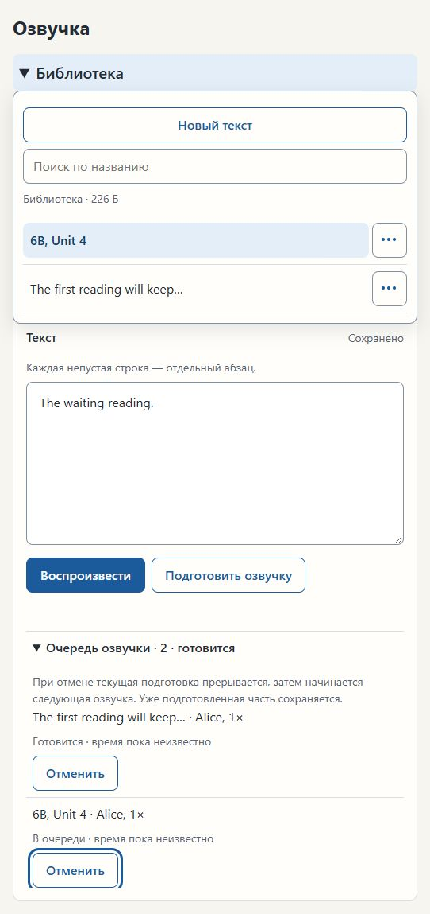
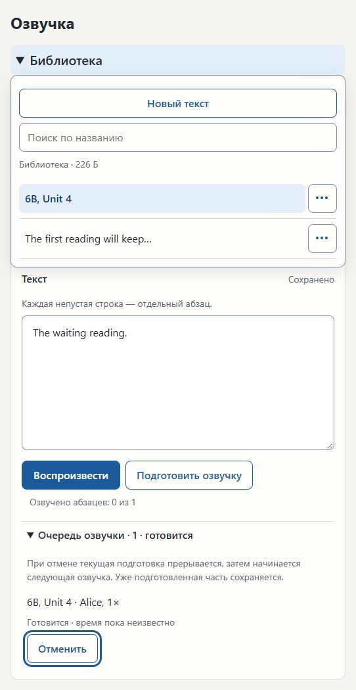

# Issue #44 — Narration queue titles

Date: 2026-11-05. Status: implementation and agent checks passed; short developer
everyday acceptance remains pending. No teacher data was used.

## Change

Core queue snapshots use the saved Text's chosen title, with the same
content-derived fallback as the Library. The page updates each existing queue
row's title and cancel button `aria-label` on every snapshot. Queue IDs still
control list reconstruction, so changing a title or progress text alone does
not replace the focused button. Queue ordering, priority and cancellation
behaviour are unchanged.

## Automated verification

Tests were written first: both custom-title cases failed with the old
content-derived queue title; the automatic-title case already passed. Three
Core-seam cases cover renaming before/after enqueue, another rename without
changing the Narration ID, and automatic title updates after editing content.

Full ordinary suite: **213 passed, 8 slow tests deselected**. `mypy`,
`ruff check` and `git diff --check` passed. No provider or build source changed;
the separate slow suite was not required. The standard release build produced
`dist/ozvuchka-issue-44.zip` (177 MB), using the local dependency wheelhouse.
Its smoke test passed: page after 1.2 s, second launch left the first running,
real Kokoro synthesized 0.85 s of speech, closing ended the program, writes
stayed in `data/`, and both startup diagnostic scenarios passed.

## Real-page browser verification

The agent used the ChatGPT in-app browser against the real Core/HTTP/page on
`http://127.0.0.1:8784/`, served by the existing
`tools/ui_design_preview.py --port 8784 --texts 0 --piece-seconds 300` seam.
Its fake provider produces silence, not evidence of real speech quality.
Disposable Library: `.cache/ui-design-preview/issue-28-0m2vzzoq`.

1. Through the UI, saved and queued two different Texts. The first was active,
   the second waiting. Queue order was first Text, then waiting Text.
2. Renamed the waiting Text through the real dialog to `6B, Unit 3`. Its Library
   title, queue row and accessible cancel name updated without re-enqueueing.
3. Focused the waiting cancel button using Tab. Its Narration ID was
   `e27533a97474|fake:alice|1.0`. In a second real-page tab, renamed the same Text
   to `6B, Unit 4`. The first page's title and cancel name updated; the focused
   button retained its accessibility ID (53) and Narration ID. Queue IDs/order
   were unchanged. DOM inspection was read-only; no mocked snapshot or page
   script injection drove the change.
4. Cancelled the first active Narration through the second page. The waiting
   Narration became `Готовится` with the same Narration ID. The first page kept
   focus on its cancel button across the progress/list update.
5. Pressed Enter in the first page. The intended Narration was cancelled, the
   queue became empty, and focus returned to the queue summary.

The paced preview had no completed synthesis-speed measurement, so numeric
ready-time countdown was unavailable. Status progress and focus were observed;
no numeric timing or real-device responsiveness claim is made.

## Short developer acceptance

Unpack `dist/ozvuchka-issue-44.zip` into a new folder with a fresh disposable
Library. Save a long English Text and a second short one. Start preparing the
first, queue the second, then rename the waiting Text. Its Library and queue
titles should agree immediately, without queueing it again. Reload, play ready
speech, delete the unwanted Text, close/wait about 10 seconds/reopen. Expect
the retained Text, title and prepared speech to remain and the deleted Text
to stay absent. Agent-owned focus checks above need not be repeated.

No new hardware-only checks were added. Existing school-device acceptance stays
in `docs/manual-checks.md`.
